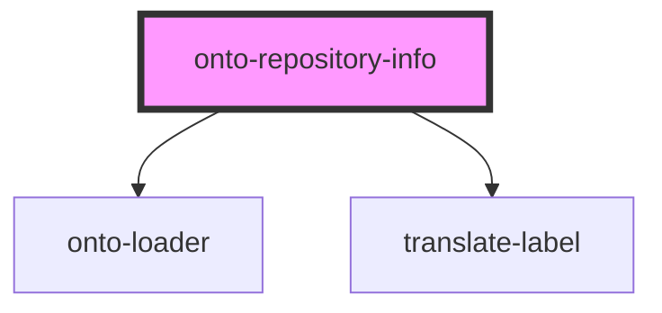

# onto-repository-info

<!-- Auto Generated Below -->

## Overview

A StencilJS component that renders the information about a repository: its id and state, description, location,
type, the permissions of the current user and the statement counts.

The component is for presentation only. It does not load anything; the consumer loads the statement counts and
passes them in. The <code>repository</code> and <code>sizeInfo</code> properties accept an object, or the same
data as JSON text for consumers that can only write the component as a tag in an HTML string.

## Properties

| Property     | Attribute    | Description                                                                                                                      | Type                                                                                                                                                                                                                       | Default     |
| ------------ | ------------ | -------------------------------------------------------------------------------------------------------------------------------- | -------------------------------------------------------------------------------------------------------------------------------------------------------------------------------------------------------------------------- | ----------- |
| `loading`    | `loading`    | Whether the statement counts are being loaded. A spinner is shown in their place.                                                | `boolean`                                                                                                                                                                                                                  | `false`     |
| `permission` | `permission` | The permission of the current user for the repository. The permissions row shows a dash without it.                              | `RepositoryPermissionType.GRAPHQL_READ \| RepositoryPermissionType.GRAPHQL_WRITE \| RepositoryPermissionType.MAINTAIN \| RepositoryPermissionType.NONE \| RepositoryPermissionType.READ \| RepositoryPermissionType.WRITE` | `undefined` |
| `repository` | `repository` | The repository to display, provided as a `Repository` object or a JSON string representing a repository.                         | `Repository \| string`                                                                                                                                                                                                     | `undefined` |
| `sizeInfo`   | `size-info`  | The statement counts to display, provided as a `RepositorySizeInfo` object or a JSON string representing a repository size info. | `RepositorySizeInfo \| string`                                                                                                                                                                                             | `undefined` |

## Dependencies

### Depends on

- [onto-loader](../onto-loader)
- [translate-label](../translate-label)

### Graph

----------------------------------------------

*Built with [StencilJS](https://stenciljs.com/)*
